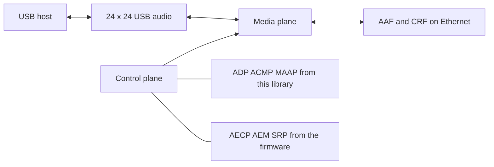

# PocketBeagle USB entity

The PocketBeagle 2 bridge connects a USB host to a Milan network.
The host sees a USB audio device with 24 playback and 24 capture channels.
The board carries them in four AAF streams each way, plus one CRF stream each way.

This library supplies the bridge's ADP, ACMP and MAAP cores and its [entity configuration](../configs/pocketbeagle.yaml).
The board image is built in the [board support repository](https://github.com/kebag-logic/ti-sitara-am65x-bsp).
Its control firmware comes from [milan-fpga](https://github.com/kebag-logic/milan-fpga).
That firmware supplies AEM, AECP and the descriptor generator. SRP comes from [lwSRP](https://github.com/kebag-logic/lwSRP).

## Use it

A controller sees one entity with five sources and five sinks.
Bind the four AAF outputs to Milan listeners, and Milan talkers to the four AAF inputs.
Each USB channel always belongs to the same stream channel:

| Stream index | Channels | USB channels | Input clusters | Output clusters |
|---|---|---|---|---|
| 0 | 8 | 1 to 8 | 0 to 7 | 24 to 31 |
| 1 | 8 | 9 to 16 | 8 to 15 | 32 to 39 |
| 2 | 4 | 17 to 20 | 16 to 19 | 40 to 43 |
| 3 | 4 | 21 to 24 | 20 to 23 | 44 to 47 |
| 4 | CRF | none | none | none |

USB host playback feeds the STREAM_OUTPUTs. The STREAM_INPUTs feed USB host capture.
Bind STREAM_INPUT 4 to a CRF talker to follow its media clock.

Choose the media clock with SET_CLOCK_SOURCE on CLOCK_DOMAIN 0.
Source 0 is internal, source 1 is the CRF input, and source 2 + k is AAF input k.

## Stream formats

All streams run at 48 kHz. AAF streams carry 32-bit PCM, six samples per channel in each PDU ([Milan v1.2 6.2][milan]).

| Stream | Current format | Accepted formats |
|---|---|---|
| AAF output 0, 1 | `0x0205022002006000`, 8 channels | That format only. |
| AAF output 2, 3 | `0x0205022001006000`, 4 channels | That format only. |
| AAF input 0, 1 | 8 channels | Every 48 kHz PCM32 format of 1 to 8 channels with six samples per PDU ([Milan v1.2 6.4][milan]). |
| AAF input 2, 3 | 4 channels | The same: every 48 kHz PCM32 format of 1 to 8 channels with six samples per PDU. |
| CRF, both ways | `0x041060010000BB80` | That format only: one timestamp every 96 samples ([Milan v1.2 7.3.2][milan]). |

Those formats include every 48 kHz Base format: 1, 2, 4, 6 and 8 channels ([Milan v1.2 6.2][milan]).
The model accepts 3, 5 and 7 channels too, which its family entry advertises ([Milan v1.2 6.5][milan]).

The firmware's AECP also refuses a format that drops a mapped channel ([Milan v1.2 5.4.2.7][milan]).
The model has no map state, so `pbaem_set_input_format` does not make that check.
Channels past a port's clusters are unmapped ([Milan v1.2 5.3.10.1][milan]).

## Design

The board's descriptors come from an end-station configuration and milan-fpga's generator.
That 4x4 + CRF configuration is not yet published in the board support repository.
Of its published branches, only `pb2-aecp-1` holds an end-station configuration, the earlier one-input shape.
The facts it states are on this page: the streams, formats, clusters, maps, clock sources and the locale `en-US`.
[milan-fpga at 58f7673b](https://github.com/kebag-logic/milan-fpga/tree/58f7673b8c57a80230e716bc1774ff9cc2f71ddc) generates the image from them.
It needs its `protocol-processor` submodule at `801ef228`, which holds the descriptor image builder.
Its hash-derived model ID, `0x001BC5C52E47A158`, depends on the shape, not on the strings.
The [configuration here](../configs/pocketbeagle.yaml) restates only the ADP, ACMP and MAAP facts, with that model ID.

The [AEM model](../include/pbaem.h) serves the same 84 descriptors from this library, for any identity.
`pbaem_descriptor` copies one descriptor into a caller buffer and refuses a short one without writing.
`pbaem_set_input_format` and `pbaem_set_clock_source` accept only what the model advertises.
With the generator's identity, its descriptors equal the generated image byte for byte.
That identity is entity ID `0x020000FFFE000001`, MAC `02:00:00:00:00:01`, name `PocketBeagle 2 bridge`, firmware version `3.96.0`, clock identity equal to the entity ID, and empty serial number and group name.
The [golden](../examples/entity_roundtrip.c) is the CRC-32, `0xD891CD2F`, of the 84 descriptors in type and index order (8105 octets).
It is checked on Linux and on RV32. A generator change that moves any descriptor needs a new golden.

The caller writes `available_index` and `identify` in the model directly.
Identity strings are 64 octets, zero padded and copied verbatim; they need no terminator.
`pbaem_descriptor` stages a descriptor on the stack: about 500 octets on RV32.



Each AAF stream has its own stream port with mono clusters.
Output ports have one static AUDIO_MAP each. Input ports have none: their maps are dynamic ([Milan v1.2 5.3.3.9][milan]).
The entity has one AVB interface and one clock domain with six clock sources.

A talker declares its stream only once a listener asks ([Milan v1.2 4.3.3.1][milan]).
That is a PROBE_TX_COMMAND within 15 seconds, or a registered Listener attribute.
The TSpecs follow [Milan v1.2 Table 4.4][milan]: 217 octets for 8 channels, 121 for 4 and 29 for CRF.
Each has one frame per class A interval, priority 3 and rank 1.
All five talkers together reserve 59.648 Mb/s, under the 75% class A limit of a 100 Mb/s link.

## Conformance by clause

| Clause | Where | Evidence |
|---|---|---|
| [IEEE 1722.1-2021][atdecc] 6.2, Milan v1.2 5.6 (ADP) | This library | [ADP tests](../tests/test_adp.cpp) and the [entity round trip](../examples/entity_roundtrip.c) on both targets. |
| [IEEE 1722.1-2021][atdecc] 8, Milan v1.2 5.5 (ACMP) | This library | [ACMP tests](../tests/test_acmp.cpp) and the entity round trip with five sinks and five sources. |
| [IEEE 1722-2016][avtp] Annex B (MAAP) | This library | [MAAP tests](../tests/test_maap.cpp) and the entity round trip with five addresses. |
| IEEE 1722.1-2021 7, Milan v1.2 5.3 (AEM) | This library and the firmware | [AEM model tests](../tests/test_pbaem.cpp) and the image golden on both targets ([AEM-01](REQUIREMENTS.md#pocketbeagle-aem-model)). |
| IEEE 1722.1-2021 9, Milan v1.2 5.4 (AECP) | Firmware | Not yet published: the board support repository's AECP suite at this shape is pending. |
| Milan v1.2 6 and 7, IEEE 1722-2016 7 and 10 (AAF, CRF) | Media plane | Not yet published at this shape: the board support repository's talker, listener and counter suites. |
| [IEEE 802.1Q-2018][dot1q] 35, Milan v1.2 4.3.3 (SRP) | Firmware with lwSRP | Not yet published: the board support repository's SRP suite is pending. |

Rows marked not yet published have no public evidence today.
This page claims no certification. Board measurements are recorded with the board image, not here.

## Validate

Run the entity checks of the [verification kit](VERIFICATION.md):

```sh
python3 scripts/entity_yaml.py --examples --check
python3 scripts/mutation.py --work build-entity-mutations --select entity- --jobs 16
python3 scripts/baremetal.py --work build-rv32 --jobs 16
```

The plant `entity-dropped-clock-sink` removes the CRF input from the generated ACMP configuration.
`EntityYaml.AcmpRoundTrip` must catch it.

[milan]: https://avnu.org/resource/milan-specification/
[atdecc]: https://standards.ieee.org/ieee/1722.1/6670/
[avtp]: https://standards.ieee.org/ieee/1722/5979/
[dot1q]: https://standards.ieee.org/ieee/802.1Q/6844/
